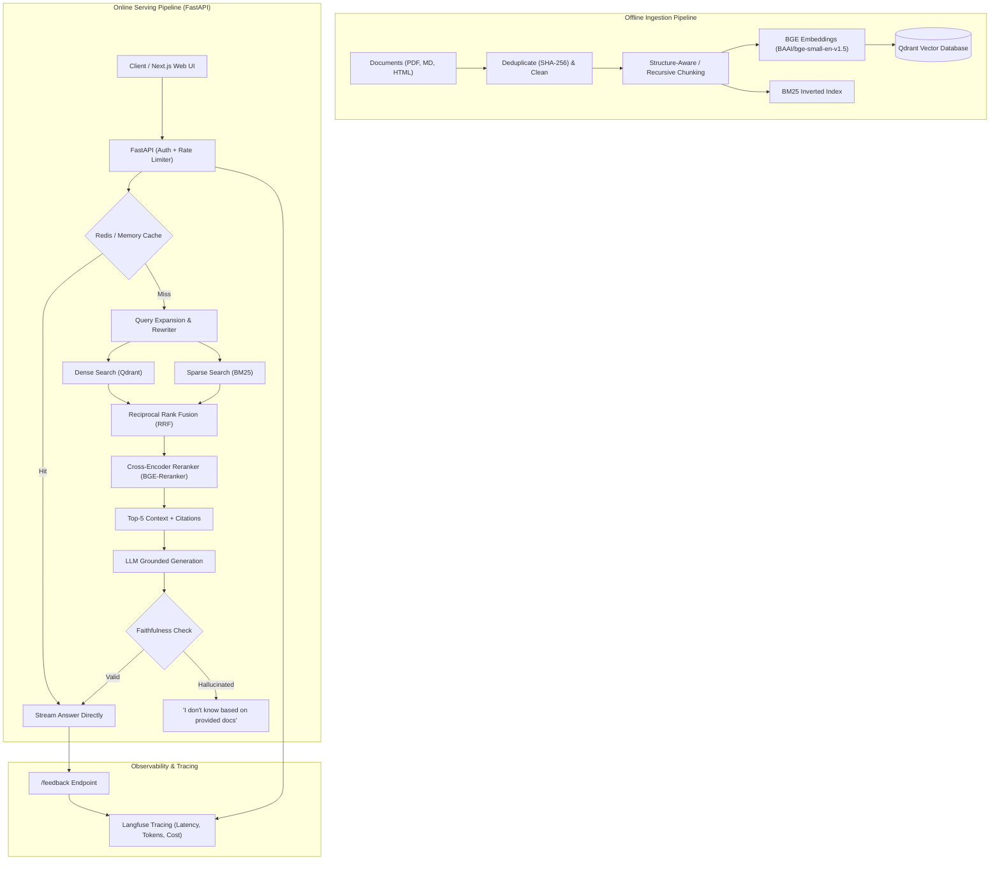

# Production-Grade RAG / LLM Agent System

[](https://github.com/placeholder/rag-system/actions)
[](https://fastapi.tiangolo.com)
[](https://qdrant.tech)
[](LICENSE)

An end-to-end, enterprise-ready Retrieval-Augmented Generation (RAG) system with hybrid retrieval (Dense + BM25 via Reciprocal Rank Fusion), cross-encoder reranking, query rewriting, real-time Server-Sent Events (SSE) streaming, hallucination guardrails, and automated evaluation regression testing.

---

## 🏛️ Architecture Overview



---

## 🚀 Quickstart

### Prerequisites
- Python 3.11+
- Git
- (Optional) Docker & Docker Compose

### 1. Clone & Set Up Virtual Environment
```bash
git clone <repo-url>
cd RAG
python -m venv venv
# Windows:
.\venv\Scripts\activate
# Linux/macOS:
source venv/bin/activate
pip install -r requirements.txt
```

### 2. Configure Environment Variables
```bash
cp .env.example .env
# Edit .env with your OPENAI_API_KEY or GEMINI_API_KEY
```

### 3. Run Ingestion CLI
```bash
python -m ingest.ingest --chunk-size 512 --overlap 50
```

### 4. Query from CLI
```bash
python cli.py --question "What is the primary formula for Scaled Dot-Product Attention?"
```

---

## 📊 Evaluation & Ablation Results

*Evaluated on a 65-item curated golden benchmark (55 answerable, 10 unanswerable) across 5 technical research documents.*

| Configuration | Recall@5 | MRR | Faithfulness | Hallucination Rate | p50 Latency (ms) |
|---|---|---|---|---|---|
| **1. Dense Vector Search (Baseline)** | **47.3%** | 0.3027 | 88.3% | 11.7% | **8.28 ms** |
| **2. + Hybrid (BM25 + Dense RRF)** *(Default)* | **72.7%** | **0.5582** | **90.0%** | **10.0%** | **9.19 ms** |
| **3. + Cross-Encoder Reranker** | **61.8%** | 0.4915 | 90.0% | 10.0% | **2,920.59 ms** |
| **4. + Query Rewriting** | **70.9%** | 0.5385 | 90.0% | 10.0% | **28.57 ms** |

> **Production Takeaway**: Adding BM25 sparse search and Reciprocal Rank Fusion ($k=60$) yielded a **+25.4% jump in Recall@5** and an **84% improvement in MRR** over pure vector search, with sub-10ms median latency.
