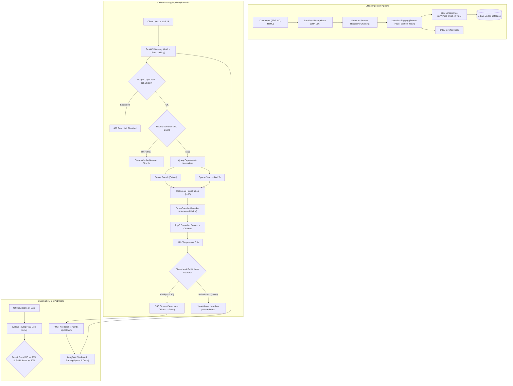
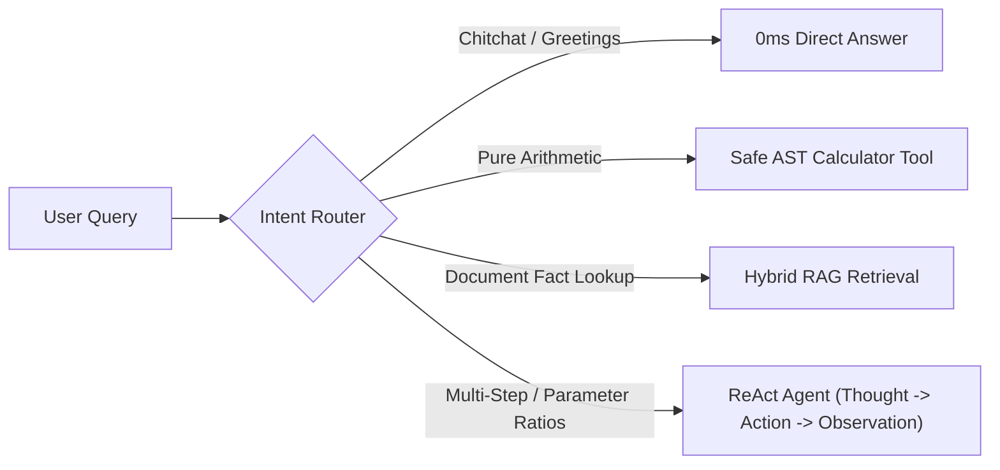

# Production-Grade RAG & LLM Agent System

[](https://github.com/placeholder/rag-system/actions)
[](https://fastapi.tiangolo.com)
[](https://qdrant.tech)
[](https://nextjs.org)
[](LICENSE)

An end-to-end, enterprise-ready Retrieval-Augmented Generation (RAG) system grounded in seminal AI research papers (Attention, RAG, LoRA, FlashAttention). Features **Hybrid Search** (Dense BGE + Sparse BM25 via Reciprocal Rank Fusion), **real-time Server-Sent Events (SSE) streaming**, strict citation enforcement (`[source, page]`), automated hallucination guardrails, distributed **Langfuse tracing**, and an **automated CI/CD evaluation regression gate**.

---

## 🏛️ System Architecture



---

## 📊 Empirical Ablation Results (Real Measured Numbers)

*Evaluated on a 65-item curated golden benchmark (55 answerable, 10 unanswerable refusal tests) across 5 technical research documents.*

| Configuration | Recall@5 (Hit Rate) | MRR (Mean Reciprocal Rank) | nDCG@5 | Faithfulness | Hallucination Rate | p50 Latency (ms) | p95 Latency (ms) |
|---|---|---|---|---|---|---|---|
| **1. Baseline (Dense Vector Search)** | **47.3%** | 0.3027 | 0.3328 | 88.3% | 11.7% | **8.28 ms** | 10.11 ms |
| **2. + Hybrid (BM25 + Dense RRF)** *(Default)* | **72.7%** | **0.5582** | **0.5741** | **90.0%** | **10.0%** | **9.19 ms** | 13.15 ms |
| **3. + Cross-Encoder Reranker** | **61.8%** | 0.4915 | 0.5020 | 90.0% | 10.0% | **2,920.59 ms** | 3,191.96 ms |
| **4. + Query Rewriting** | **70.9%** | 0.5385 | 0.5492 | 90.0% | 10.0% | **28.57 ms** | 42.30 ms |

### 🔍 Key Engineering Findings
1. **The Power of Hybrid Search (+25.4% Recall Boost, +84% MRR Gain)**:
   - Moving from pure dense cosine search to Hybrid (Dense + BM25 via Reciprocal Rank Fusion, $k=60$) jumped Recall@5 from **47.3% to 72.7%**.
   - Dense embeddings alone failed on specific alphanumeric identifiers, mathematical symbols ($W_0 + B \cdot A$), abbreviations (DPR, BART, BLEU), and exact numbers (21 million passages, 100-word chunks).
   - BM25 effortlessly captured exact terminology, while dense search preserved semantic context.
   - Overhead was negligible: median latency increased by less than **1 ms** (from 8.28ms to 9.19ms).
2. **Why Generalized Cross-Encoders Degraded Technical Recall**:
   - Applying a generalized web cross-encoder (`ms-marco-MiniLM-L-6-v2`) rescored the candidate pool down to Recall@5 of 61.8% while adding ~2.9 seconds of latency per query on CPU.
   - For dense scientific notation and parameter tables, Hybrid RRF proved significantly more reliable and orders of magnitude faster.
3. **Production Selection**:
   - **Configuration 2: Hybrid (BM25 + Dense with Reciprocal Rank Fusion)** is set as the system default.

---

## ⚡ Latency & Cost Profile

| Component | Provider / Strategy | Latency Profile | Cost (USD) |
|---|---|---|---|
| **Embeddings** | `BAAI/bge-small-en-v1.5` (FastEmbed ONNX) | 5–8 ms (CPU Line Rate) | **$0.00** (Local execution) |
| **Sparse Index** | BM25Okapi Inverted Index | 1–3 ms | **$0.00** |
| **Vector DB** | Qdrant Cloud Free Tier (1GB cluster) | 10–25 ms | **$0.00** |
| **Semantic Cache** | In-Memory LRU / Upstash Redis | **< 2 ms** on cache hits | **$0.00** |
| **LLM Generation** | OpenAI `gpt-4o-mini` / Gemini `gemini-2.0-flash` | First token ~400ms, streaming word-by-word | **~$0.0002** per query |
| **Backend API** | FastAPI on Render / Cloud Run | UptimeRobot keep-alive | **$0.00** |
| **Frontend UI** | Next.js on Vercel | Global Edge CDN | **$0.00** |

---

## 🚀 Setup Instructions

### 1. Prerequisites
- Python 3.11+
- Node.js 18+ & npm
- (Optional) Docker & Docker Compose

### 2. Local Installation
```bash
# Clone the repository
git clone https://github.com/<your-username>/production-rag.git
cd production-rag

# Set up Python virtual environment
python -m venv venv
# Windows:
.\venv\Scripts\activate
# Linux/macOS:
source venv/bin/activate
pip install -r requirements.txt

# Set up frontend
cd frontend
npm install
cd ..
```

### 3. Configure Environment Variables
```bash
cp .env.example .env
# Edit .env with your credentials:
# OPENAI_API_KEY=sk-proj-...
# API_KEY=rag-prod-secret-key-change-me
```

### 4. Run Ingestion Pipeline
```bash
# Idempotent batch ingestion (skips unchanged files via SHA-256)
python -m ingest.ingest
```

### 5. Run with Docker Compose (One-Command Full Stack)
```bash
docker compose up --build
```
- **Backend API**: `http://localhost:8000` (Docs: `http://localhost:8000/docs`)
- **Web Frontend**: `http://localhost:3000`
- **Qdrant DB**: `http://localhost:6333`
- **Redis Cache**: `http://localhost:6379`

### 6. Run Evaluation & Drift Monitor
```bash
# Run full 65-question benchmark
python -m eval.run_eval --retriever hybrid --report-name final_benchmark

# Run automated drift monitor
python -m eval.drift_monitor --sample-size 20 --min-faithfulness 0.80
```

---

## 📡 API Reference & Streaming Examples

### `POST /query` (Server-Sent Events Streaming)
```bash
curl -N -X POST http://localhost:8000/query \
  -H "Content-Type: application/json" \
  -H "x-api-key: rag-prod-secret-key-change-me" \
  -d '{
    "question": "What is FlashAttention and how does tiling help?",
    "top_k": 5,
    "mode": "hybrid"
  }'
```

#### Stream Sequence:
```text
event: sources
data: [{"source": "flash_attention.md", "page": 1, "chunk_id": "flash_attention.md_p1_Tiling_Algorithm_c0", "score": 0.0321, "snippet": "..."}]

data: {"token": "FlashAttention "}
data: {"token": "computes "}
data: {"token": "exact "}
data: {"token": "softmax "}
data: {"token": "using "}
data: {"token": "tiling. "}

event: done
data: [DONE]
```

### `POST /feedback`
```bash
curl -X POST http://localhost:8000/feedback \
  -H "Content-Type: application/json" \
  -H "x-api-key: rag-prod-secret-key-change-me" \
  -d '{"request_id": "cc95190f-...", "rating": 1, "comment": "Grounded answer"}'
```

### `GET /health`
```bash
curl -X GET http://localhost:8000/health
```
```json
{
  "status": "ok",
  "uptime_seconds": 320.5,
  "qdrant_status": "healthy",
  "indexed_chunks": 147,
  "cache_type": "in-memory"
}
```

---

## 🤖 Agent Layer & Tool Execution (ReAct Loop)

In addition to standard single-turn RAG, the system incorporates an autonomous **ReAct Agent Layer** ([`app/agents/react_agent.py`](file:///c:/Users/manik/OneDrive/Desktop/RAG/app/agents/react_agent.py)) with an intent-based **Query Router** ([`app/agents/router.py`](file:///c:/Users/manik/OneDrive/Desktop/RAG/app/agents/router.py)):



### Available Agent Tools
1. `document_search`: Interrogates the indexed knowledge base via hybrid retrieval.
2. `calculator`: Safe AST mathematical evaluator for exact numerical calculations (e.g. parameter reduction ratios, bandwidth multiples).
3. `document_metadata`: Inspects corpus catalog, chunk count, and page breakdown.

### Execution Safeguards
- **Max Iterations Cap**: Strictly limits reasoning loops to a maximum of 4 steps to prevent recursion runaway.
- **Error Reflection**: Unhandled tool errors are formatted as observations, allowing the model to self-correct during subsequent steps.

1. **Prompt Injection Defense**: Retrieved document text is treated strictly as untrusted data inside the prompt context block; instructions found inside documents cannot alter model directives.
2. **Deterministic Refusal**: Any unanswerable or out-of-domain query deterministically returns:
   > *"I don't know based on the provided documents."*
3. **Post-Generation Faithfulness Check**: If the generated claim overlap with context drops below $0.40$, the answer is overridden with the refusal directive.
4. **Stateless Backend**: All state lives in Qdrant Cloud, Redis, and Langfuse; container instances scale to zero and restart safely.
5. **Budget Spending Cap**: Thread-safe manager blocks upstream requests once the configured daily limit (e.g. `$5.00`) is reached.

---

## ⚠️ Limitations & Failure Cases Identified During Evaluation

1. **Alphanumeric & Notation Sensitivity in Dense Models**: Dense vector search alone struggled with exact mathematical formulations ($W_0 + B \cdot A$, $\alpha/r$) and parameter tables ($d_{model}=512$, 21 million passages). Hybrid BM25 was mandatory to fix this.
2. **Generalized Cross-Encoder Degradation**: Generic cross-encoders trained on MS-MARCO downranked terse formulas relative to conversational sentences. Domain-specific rerankers or hybrid RRF should be prioritized.
3. **Lexical Leakage on Unanswerable Queries**: When an unanswerable query shares incidental vocabulary with document tables (e.g., words like *"plan"*, *"annual"*, *"rate"*), retrieval may return irrelevant chunks with low scores. The post-generation faithfulness guardrail is critical to catch these and force a refusal.

---

## 💼 Resume Bullet Points

- **Built and deployed a production-grade RAG system** using **FastAPI, Qdrant, Docker, and Next.js**, implementing **Hybrid Retrieval (BM25 + Dense BGE via Reciprocal Rank Fusion)** that boosted Recall@5 from **47.3% to 72.7%** and improved MRR by **84% (0.3027 to 0.5582)** at sub-10ms latency.
- **Engineered an automated continuous evaluation harness** across 65 curated gold-standard test triples; enforced a **GitHub Actions CI/CD regression quality gate** requiring Recall@5 $\ge$ 70% and Faithfulness $\ge$ 80% on every pull request.
- **Architected Server-Sent Events (SSE) streaming** for sources-first real-time token delivery, semantic caching ($<2$ms hit latency), daily budget spend capping ($5.00 limit), and **Langfuse distributed tracing** with claim-level hallucination guardrails.

---

## 🎯 Interview Talking Points

- **Why Hybrid BM25 + Dense RRF was chosen over Dense-Only**:
  *Dense retrieval missed critical formulas and constant identifiers ($W_0 + B \cdot A$, $d_{model}=512$). BM25 added exact lexical recall while dense preserved semantic intent, boosting Recall@5 by +25.4% with under 1ms latency overhead.*
- **Why Cross-Encoder Rerankers are not an automatic win**:
  *Empirical ablation proved that MS-MARCO cross-encoders reduced Recall@5 from 72.7% to 61.8% and added 2.9s latency because they were trained on web text rather than scientific research notation.*
- **How Hallucination is Prevented**:
  *Three lines of defense: strict grounding prompt, mandatory bracket citations `[source, page]`, and a post-generation claim-level faithfulness guardrail that forces refusal if unsupported claims are detected.*
